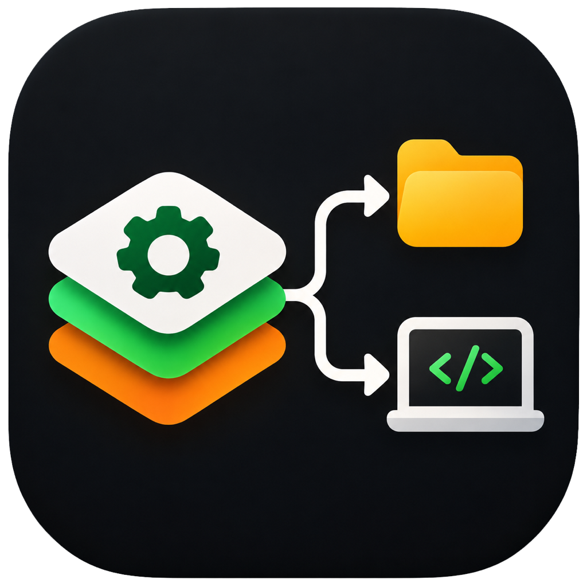

#  Skill-Manager

**Skill-Manager** is a high-performance cross-platform desktop application built in Rust and [Dioxus 0.7](https://dioxuslabs.com/) designed to discover, distribute, and synchronize LLM agent skills across multiple AI coding assistants, development projects, and global environments.

---

## Downloads & Releases

Pre-compiled desktop applications are automatically built and released for macOS, Windows, and Linux via GitHub Actions CI:

👉 **[Download the Latest Release for your OS](https://github.com/Starraider/skill-manager/releases/latest)**

| Operating System | Architecture | Installer / Package | Standalone Archive |
| :--- | :--- | :--- | :--- |
| **macOS** | Apple Silicon (`arm64` / M1/M2/M3/M4) | [`.dmg` Installer](https://github.com/Starraider/skill-manager/releases/latest/download/SkillManager-macos-aarch64.dmg) | [`.zip` (`.app`)](https://github.com/Starraider/skill-manager/releases/latest/download/SkillManager-macos-aarch64.zip) |
| **macOS** | Intel (`x86_64`) | [`.dmg` Installer](https://github.com/Starraider/skill-manager/releases/latest/download/SkillManager-macos-x86_64.dmg) | [`.zip` (`.app`)](https://github.com/Starraider/skill-manager/releases/latest/download/SkillManager-macos-x86_64.zip) |
| **Windows** | 64-bit (`x86_64`) | [`.msi` Installer](https://github.com/Starraider/skill-manager/releases/latest/download/SkillManager-windows-x86_64.msi) | [`.zip` (`skill-manager.exe`)](https://github.com/Starraider/skill-manager/releases/latest/download/SkillManager-windows-x86_64.zip) |
| **Linux** | 64-bit (`x86_64`) | [`.deb`](https://github.com/Starraider/skill-manager/releases/latest/download/SkillManager-linux-x86_64.deb) / [`.AppImage`](https://github.com/Starraider/skill-manager/releases/latest/download/SkillManager-linux-x86_64.AppImage) | [`.tar.gz` (`skill-manager`)](https://github.com/Starraider/skill-manager/releases/latest/download/SkillManager-linux-x86_64.tar.gz) |

> [!NOTE]
> All binaries are built and bundled using the automated [GitHub Actions CI Workflow](.github/workflows/release.yml) whenever a new version tag (e.g. `v0.1.0`) is pushed. To view previous versions, visit the [Releases Archive](https://github.com/Starraider/skill-manager/releases).

---

## Table of Contents

- [Downloads & Releases](#downloads--releases)
- [What Skill-Manager Does](#what-skill-manager-does)
  - [The Problem](#the-problem)
  - [How Skill-Manager Solves It](#how-skill-manager-solves-it)
  - [Core Features & Architecture](#core-features--architecture)
  - [Key Concepts](#key-concepts)
  - [How to use Skill Manager](#how-to-use-skill-manager)
  - [Built-In Harness Defaults](#built-in-harness-defaults)
- [How to Compile Skill-Manager](#how-to-compile-skill-manager)
  - [Prerequisites & System Dependencies](#prerequisites--system-dependencies)
  - [Compiling with Cargo (Standalone Binary)](#1-compiling-with-cargo-standalone-binary)
  - [Compiling with Dioxus CLI (Application Bundles)](#2-compiling-with-dioxus-cli-application-bundles)
  - [Automated Multi-Platform CI Builds](#3-automated-multi-platform-ci-builds-github-actions)
  - [Running Tests Prior to Compilation](#running-tests-prior-to-compilation)
- [How to Start the Fully Compiled Program](#how-to-start-the-fully-compiled-program)
  - [Starting the Standalone Binary](#1-starting-the-standalone-binary)
  - [Starting the OS Desktop Bundle](#2-starting-the-os-desktop-bundle)
  - [Installing System-Wide](#3-installing-system-wide)
  - [First Launch & Configuration](#first-launch--configuration)
  - [Quick-Start User Workflow](#quick-start-user-workflow)
- [Project Structure](#project-structure)
- [License](#license)

---

## What Skill-Manager Does

### The Problem

Modern AI-assisted software development relies on diverse agentic coding tools—such as **OpenAI Codex**, **Anthropic Claude Code**, **Cursor**, and **Google Antigravity**. While agent skills provide a standard way to extend these assistants with domain-specific knowledge, tools, and workflows, each assistant relies on distinct filesystem conventions:

- Project-level relative directories vary widely (e.g., `.codex/skills`, `.claude/skills`, `.cursor/skills`, `.antigravity/skills`).
- Global user directories are fragmented (e.g., `~/.agents/skills`, `~/.claude/skills`, `~/.cursor/skills`, `~/.gemini/antigravity/skills`).
- Maintaining custom skills across dozens of local project repositories and global paths requires tedious, error-prone manual file copying or ad-hoc shell scripts.
- Unused AI skills should be removed from projects because their descriptions and system prompts are repeatedly injected into the LLM context, creating constant token overhead and unnecessarily inflating operational costs during every request.
- There is no central interface to inspect which skills are active in a project or remove a skill cleanly across all tools in one step.

### How Skill-Manager Solves It

Skill-Manager provides a centralized native desktop dashboard that acts as the single control plane for your agent skills:

1. **Automatic Skill Discovery**: Scans your local source repositories for valid skill packages marked by `SKILL.md` (or `skill.md`), parsing YAML frontmatter metadata (name, title, description).
2. **Multi-Harness Fan-Out Deployment**: Lets you select one or more skills and fan them out across all configured harnesses and target repositories (or system-wide global directories) in a single click.
3. **Smart Path Canonicalization & Deduplication**: Canonicalizes and deduplicates destination paths before executing copy or deletion operations, guaranteeing that shared folders receive exactly one write.
4. **Parent Directory Initialization**: Automatically creates missing directory trees (`create_dir_all`) as needed.
5. **Synchronized Multi-Harness Removal**: Uninstalling a skill from a project or global target wipes it from all associated harness subdirectories in one atomic action, leaving your original source files untouched.
6. **Resilient Non-Blocking I/O**: Filesystem operations (scanning, deep copying, deletion) run asynchronously in background threads, keeping the desktop UI fluid and responsive even during large batch deployments.
7. **Atomic, Self-Healing Configuration**: All sources, targets, and harnesses are saved atomically to `~/.config/skill-manager/config.json`. If corrupted or absent, the app gracefully recovers with safe, pre-seeded defaults.

---

### Core Features & Architecture

```text
+-----------------------------------------------------------------------------------+
|                                  Dioxus 0.7 GUI                                   |
|   [Tab 1: Sources]              [Tab 2: Targets]            [Tab 3: Harnesses]    |
|   • Source directories          • Project directories       • Harness matrix      |
|   • Skill discovery & parsing   • Installed skills view     • Relative & global   |
|   • Multi-select & Copy Modal   • Synchronized removal      • Custom harnesses    |
+-----------------------------------------------------------------------------------+
                                          |
                                          v
+-----------------------------------------------------------------------------------+
|                                Core Engine Services                               |
|   • fs_scanner: Detects SKILL.md, parses YAML frontmatter, sanitizes names        |
|   • deployer: Fan-out copy, path deduplication, directory init, error resilience  |
|   • config_store: Atomic persistence (~/.config/skill-manager/config.json)        |
+-----------------------------------------------------------------------------------+
```

- **Native OS Dialogs**: Integrates native folder pickers via `rfd` (Rust File Dialogs) for choosing source and target paths.
- **Zero Runtime Dependencies**: The UI is styled with embedded CSS (`include_str!("../../assets/style.css")`), compiling into a single self-contained binary that uses the native OS webview (WebKit on macOS/Linux, WebView2 on Windows).
- **Graceful Error Resilience**: If copying to one harness fails (e.g., due to permissions), Skill-Manager reports the error for that harness without aborting deployment to the others.

---

### Key Concepts

| Concept | Description |
| :--- | :--- |
| **Source** | A local folder containing your authored or cloned skills. Immediate subdirectories containing a `SKILL.md` (or `skill.md`) marker are identified as valid skills. |
| **Skill** | A discrete directory containing instructions (`SKILL.md`), scripts, documentation, and assets. Frontmatter like `name`, `title`, and `description` is parsed automatically. |
| **Target** | A destination where skills are deployed. Can be any **Project Directory** (local git repo) or the built-in **Global** target. |
| **Global Target** | A pinned target that distributes skills across all harness user-level/global paths (e.g., `~/.claude/skills`, `~/.agents/skills`). |
| **Harness** | An AI coding assistant definition specifying its relative project directory (e.g., `.cursor/skills`) and an optional global directory (e.g., `~/.cursor/skills`). |

---

### How to use Skill Manager

Follow these steps to add skills to a project:

1. **Select the harnesses you are using and verify their local path and global path.**
   Open the **Harnesses** tab to review the AI coding assistants you work with (e.g., Claude Code, Cursor, Codex). Verify that their local (relative) and global skill directory paths match your setup, or customize them as needed. Remove the preconfigured harnesses if you are not using them. Leave the "Default" harness untouched, which is used for the "Global" distribution target.

2. **Add a source path.**
   Navigate to the **Sources** tab and click **+ Add** to add the directory where your skills are stored or authored. Skill-Manager will scan the directory and list all detected skills.

3. **Add a target.**
   Switch to the **Targets** tab and click **+ Add** to register your project repository directory as a destination (the built-in **Global** target is also available for system-wide installations).

4. **In the sources list, select the desired skills, click "Copy Skills", and then choose the target.**
   Return to the **Sources** tab, check the boxes next to the skills you want to add, click the **Copy Skills** button in the toolbar, and select your target project in the dialog to deploy the skills across all configured harness folders.

Follow these steps to remove skills from a project:

1. Switch to the **Targets** tab.
2. Select the target project in the list.
3. Select skills which you want to remove.
4. Click the **Remove Skills** button in the toolbar

---

### Built-In Harness Defaults

Skill-Manager comes pre-configured with 11 major AI coding assistants and harnesses:

| Harness | Project Relative Path | Global Path | Supported Standards & Notes |
| :--- | :--- | :--- | :--- |
| **OpenAI Codex** | `.agents/skills` | `~/.agents/skills` | Vendor-neutral standard (legacy fallback: `.codex/skills`) |
| **Claude Code** | `.claude/skills` | `~/.claude/skills` | Tool-specific proprietary path (`.claude/skills`) |
| **Cursor** | `.agents/skills` | `~/.agents/skills` | Vendor-neutral standard (also supports `.cursor/skills`) |
| **Google Antigravity** | `.agents/skills` | `~/.agents/skills` | Vendor-neutral standard (also supports `~/.gemini/config/skills`) |
| **OpenCode** | `.agents/skills` | `~/.agents/skills` | Vendor-neutral standard (also supports `.opencode/skills`) |
| **GitHub Copilot** | `.agents/skills` | `~/.agents/skills` | Vendor-neutral standard (also supports `.github/skills`) |
| **Windsurf** | `.agents/skills` | `~/.agents/skills` | Vendor-neutral standard (also supports `.windsurf/skills`) |
| **Pi** | `.agents/skills` | `~/.agents/skills` | Vendor-neutral standard (also supports `.pi/skills`) |
| **Cline** | `.agents/skills` | `~/.agents/skills` | Vendor-neutral standard (also supports `.cline/skills`) |
| **Qoder** | `.qoder/skills` | `~/.qoder/skills` | Tool-specific proprietary path (`.qoder/skills`) |
| **Roo Code** | `.agents/skills` | `~/.agents/skills` | Vendor-neutral standard (also supports `.roo/skills`) |

> [!NOTE]
> **Standard Path Preference Principle**: Wherever an AI assistant natively supports the open, vendor-neutral `.agents/skills` specification, Skill-Manager adopts it as the default. Thanks to Skill-Manager's automatic path deduplication and canonicalization, deploying to multiple harnesses that share `.agents/skills` performs a single, safe disk write without duplicate copies or write conflicts.

You can freely add, modify, or remove custom harnesses directly within the **Harnesses** tab.

---

## How to Compile Skill-Manager

Skill-Manager is written in Rust (2021 edition) and uses Dioxus 0.7 Desktop.

### Prerequisites & System Dependencies

Ensure you have the Rust toolchain (compiler, cargo, and standard library) installed. If you do not have Rust installed:

```bash
curl --proto '=https' --tlsv1.2 -sSf https://sh.rustup.rs | sh
source "$HOME/.cargo/env"
```

Verify your installation:

```bash
rustc --version # Rust 1.75 or later is recommended
cargo --version
```

#### OS-Specific Dependencies

Because Skill-Manager runs as a native desktop application using the system webview, your operating system may require specific development libraries:

- **macOS**:
  - Requires Xcode Command Line Tools:

    ```bash
    xcode-select --install
    ```

- **Linux (Debian / Ubuntu / Pop!_OS)**:
  - Requires GTK3, WebKit2GTK, and X11 development packages:

    ```bash
    sudo apt-get update
    sudo apt-get install -y libwebkit2gtk-4.1-dev libgtk-3-dev libxdo-dev libayatana-appindicator3-dev librsvg2-dev libssl-dev pkg-config build-essential
    ```

  *(Note: If your distribution uses WebKit2GTK 4.0, install `libwebkit2gtk-4.0-dev` instead.)*

- **Linux (Fedora / RHEL)**:

  ```bash
  sudo dnf install webkit2gtk4.1-devel gtk3-devel libxdo-devel libayatana-appindicator3-devel openssl-devel
  ```

- **Linux (Arch Linux)**:

  ```bash
  sudo pacman -S webkit2gtk-4.1 gtk3 xdotool libappindicator-gtk3
  ```

- **Windows**:
  - Microsoft Visual Studio C++ Build Tools (or Visual Studio Community).
  - Microsoft Edge WebView2 (pre-installed by default on Windows 10 and 11).

---

### 1. Compiling with Cargo (Standalone Binary)

The most direct way to compile Skill-Manager into an optimized, finished executable is using standard `cargo`:

```bash
# Clone or navigate to the repository
cd skill-manager

# Build optimized release binary
cargo build --release
```

#### Compilation Output

- **macOS / Linux**: `target/release/skill-manager`
- **Windows**: `target\release\skill-manager.exe`

This standalone binary embeds all styling and application logic. It can be moved or copied anywhere on your system.

---

### 2. Compiling with Dioxus CLI (Application Bundles)

If you want native OS installers or bundles (such as a macOS `.app` / `.dmg`, a Linux `.deb` / `.AppImage`, or a Windows `.msi` / installer), use the official Dioxus CLI:

1. **Install the Dioxus CLI** (if not already installed):

   ```bash
   cargo install dioxus-cli --locked
   ```

2. **Bundle the Release Application**:

   ```bash
   dx bundle --release
   ```

#### Bundle Output Locations

- **macOS**: `target/dx/skill-manager/release/macos/Skill-Manager.app` (and `.dmg`)
- **Linux**: `target/dx/skill-manager/release/linux/` (`.deb`, `.AppImage`)
- **Windows**: `target\dx\skill-manager\release\windows\` (installer or portable package)

---

### 3. Automated Multi-Platform CI Builds (GitHub Actions)

Instead of manually maintaining cross-compilation toolchains on a single machine, this repository includes an automated GitHub Actions CI release pipeline ([`.github/workflows/release.yml`](.github/workflows/release.yml)).

Whenever a Git version tag (e.g., `v0.1.0`) is pushed, GitHub Actions automatically:

1. Spins up native matrix runners:
   - **macOS (Apple Silicon `aarch64` & Intel `x86_64`)**
   - **Windows (`x86_64`)**
   - **Linux (`x86_64`)**
2. Compiles optimized binaries and runs the test suite.
3. Generates native application packages (`.dmg`, `.deb`, `.AppImage`, `.msi`) and portable archives (`.zip`, `.tar.gz`).
4. Creates a public GitHub Release and uploads all assets.

To trigger an automated build and release:

```bash
git tag -a v0.1.0 -m "Release v0.1.0"
git push origin v0.1.0
```

You can also manually trigger builds via the **Run workflow** button in the GitHub repository's **Actions** tab.

---

### Running Tests Prior to Compilation

To run the automated test suite (verifying config storage, discovery scanning, frontmatter parsing, deduplication, and deployment):

```bash
cargo test
```

All integration tests run within temporary isolated sandboxes without modifying your home directory or existing configuration files.

---

## How to Start the Fully Compiled Program

### 1. Starting the Standalone Binary

Once compiled via `cargo build --release`, launch the executable directly from the command line:

#### macOS / Linux

```bash
./target/release/skill-manager
```

#### Windows

```powershell
.\target\release\skill-manager.exe
```

---

### 2. Starting the OS Desktop Bundle

If you bundled the application using `dx bundle --release`:

#### macOS

Launch directly from the terminal:

```bash
open target/dx/skill-manager/release/macos/Skill-Manager.app
```

Or copy it to your personal or system Applications directory to launch via Spotlight or Launchpad:

```bash
cp -r target/dx/skill-manager/release/macos/Skill-Manager.app /Applications/
```

#### Linux

Make the AppImage executable and launch it:

```bash
chmod +x target/dx/skill-manager/release/linux/*.AppImage
./target/dx/skill-manager/release/linux/*.AppImage
```

Or install the `.deb` package:

```bash
sudo dpkg -i target/dx/skill-manager/release/linux/*.deb
skill-manager
```

#### Windows

Double-click the generated `.exe` or run the installer located in `target\dx\skill-manager\release\windows\`.

---

### 3. Installing System-Wide

To install the compiled binary into your user's Cargo binary directory (usually `~/.cargo/bin`, already present in `$PATH`):

```bash
cargo install --path .
```

You can now start Skill-Manager from any terminal simply by executing:

```bash
skill-manager
```

---

### First Launch & Configuration

When Skill-Manager launches for the first time, it automatically creates its configuration file at:

- **macOS / Linux**: `~/.config/skill-manager/config.json`
- **Windows**: `%APPDATA%\skill-manager\config.json`

The file is seeded with the 11 default harness definitions (OpenAI Codex, Claude Code, Cursor, Google Antigravity, OpenCode, GitHub Copilot, Windsurf, Pi, Cline, Qoder, Roo Code) and the pinned **Global** target. Any updates made through the user interface are saved atomically to this file.

---

### Quick-Start User Workflow

1. **Step 1: Add a Source Directory**
   - Click the **1. Sources** tab in the top navigation.
   - Click **+ Add** to add a source directory. In the dialog, assign a custom display name (independent of the filesystem path, e.g. `"TYPO3 Skill"`) and select or enter its directory path (e.g. `/Users/svenkalbhenn/Skills/typo3`).
   - You can edit or rename any source anytime by clicking **Edit** in the toolbar, the **✎** button on the card, or by double-clicking the item card.
   - Skill-Manager scans immediate subdirectories and lists all valid skills with their titles and descriptions.

2. **Step 2: Add Target Projects (Optional)**
   - Click the **2. Targets** tab.
   - Click **+ Add** to add a project destination. Assign a custom name (e.g. `"My Project"`) and choose or enter its project path (e.g. `/Users/svenkalbhenn/Projekte/kunden-projekt`).
   - You can edit or rename any target anytime by clicking **Edit**, the **✎** button, or double-clicking the item card.
   - The built-in **Global** target is always available.

3. **Step 3: Deploy Skills**
   - Return to the **Sources** tab.
   - Select the checkboxes for the skills you wish to distribute (or click **Select All**).
   - Click **Copy Skills (N)** in the toolbar.
   - In the deployment modal, check the destination target(s) (e.g., `web-app` or `Global`) and click **Deploy**.
   - Skill-Manager creates any missing harness directories, deduplicates paths, copies the skills, and confirms the deployment.

4. **Step 4: Inspect & Synchronize Removal**
   - In the **Targets** tab, select any target project to see all installed skills and the harnesses they support.
   - Click **Remove Skill** next to any installed skill to delete it cleanly across all configured harness folders for that project.

5. **Step 5: Configure Custom Harnesses**
   - Click the **3. Harnesses** tab to view or customize relative paths, global paths, or add new AI assistants.

---

## Project Structure

```text
skill-manager/
├── Cargo.toml               # Rust package definition and dependencies
├── Dioxus.toml              # Dioxus desktop bundle configuration
├── assets/
│   └── style.css            # Dark-mode desktop application styling
├── docs/
│   └── designs/             # Architecture and design specifications
├── src/
│   ├── main.rs              # Application entrypoint & desktop window initialization
│   ├── lib.rs               # Library exports
│   ├── error.rs             # Error types (AppError)
│   ├── components/          # Dioxus UI components
│   │   ├── layout.rs        # Main window layout, header, and tab navigation
│   │   ├── tab_sources.rs   # Tab 1: Source directory and skill discovery list
│   │   ├── tab_targets.rs   # Tab 2: Project targets and installed skill management
│   │   ├── tab_harnesses.rs # Tab 3: Harness matrix and configuration
│   │   ├── copy_modal.rs    # Skill deployment fan-out modal dialog
│   │   └── common.rs        # Reusable badges, buttons, and alert components
│   ├── models/              # Data structures and domain models
│   │   ├── config.rs        # AppConfig, SourceConfig, TargetConfig, HarnessConfig
│   │   ├── skill.rs         # Skill, InstalledSkill, DeploymentResult
│   │   └── state.rs         # Reactive AppState signals and ActiveTab enum
│   └── services/            # Core filesystem and persistence engines
│       ├── fs_scanner.rs    # Directory scanner and YAML frontmatter extractor
│       ├── deployer.rs      # Fan-out copy, path deduplication, and removal engine
│       └── config_store.rs  # Atomic JSON configuration persistence and tilde expansion
└── tests/                   # Automated integration test suite
    ├── common/              # Test fixtures and temporary directory builders
    ├── config_store_tests.rs
    ├── deployer_tests.rs
    └── fs_scanner_tests.rs
```

---

## License

This project is licensed under the [Creative Commons Attribution 4.0 International License (CC BY 4.0)](LICENSE).

Copyright (c) 2026 Sven Kalbhenn ([https://www.skom.de](https://www.skom.de)).
