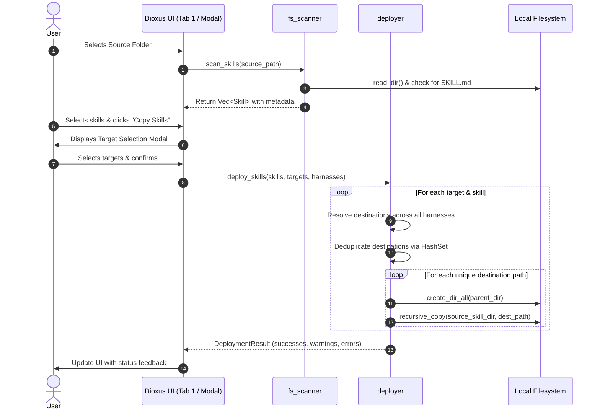

# Skill-Manager Design Document

* **Author:** Sven Kalbhenn
* **Status:** Draft
* **Date:** 2026-11-02

--------------------------------------------------------------------------------

## Overview

Skill-Manager is a desktop application built in Rust using Dioxus 0.7 for managing and distributing LLM agent skills. Development workflows frequently rely on multiple AI coding assistants—such as Codex, Claude Code, Cursor, and Antigravity—each maintaining distinct configuration and skill directory conventions. Skill-Manager centralizes skill discovery from local source repositories and automates distribution across all target projects and global agent environments.

The application discovers skills strictly identified by a `SKILL.md` marker file in immediate source subdirectories. When a user deploys skills to a project target or the system-wide Global target, Skill-Manager fans out full directory copies to all configured harnesses. Destination paths are deduplicated prior to execution so shared folders receive exactly one write. Application configuration is maintained in a single, atomically written configuration file (`~/.config/skill-manager/config.json`).

--------------------------------------------------------------------------------

## The Problem

Developers using agentic AI tools face high friction and fragmentation:

1. **Fragmented Directory Conventions**: Each AI harness uses different relative directories in project repositories (e.g., `.codex/skills`, `.claude/skills`, `.cursor/skills`, `.antigravity/skills`) and different global user paths (e.g., `~/.agents/skills`, `~/.claude/skills`).
2. **Manual and Error-Prone Replication**: Keeping custom skills updated across multiple projects and harnesses requires repetitive manual file copying or command-line scripting, resulting in outdated or partially copied skills.
3. **Overlapping Path Redundancy**: Multiple harnesses sometimes share identical folder paths (such as multiple tools standardizing on `.claude/skills` or shared global directories). Naive copy scripts perform redundant overwrites or encounter file lock conflicts.
4. **Lack of Centralized Visibility**: There is no straightforward way to view which skills are installed in a given project, which harnesses are currently configured with those skills, or to cleanly remove a skill across all harnesses in a single action.

Skill-Manager solves this by providing a unified, dark-themed desktop interface to scan source directories, view discovered skills, fan out copies to project or global targets with automatic path deduplication, and inspect or delete installed skills consistently across all harnesses.

--------------------------------------------------------------------------------

## Goals

* **Native Cross-Platform Desktop UI**: Deliver a responsive desktop interface using Rust and Dioxus 0.7 with dark mode styling and native OS directory pickers via `rfd`.
* **Strict Skill Discovery**: Automatically detect valid agent skills within configured source folders by requiring an immediate child directory containing a `SKILL.md` marker file.
* **Multi-Harness Fan-Out**: Support selecting multiple skills and copying them simultaneously to selected target projects across all defined harnesses.
* **Destination Path Deduplication**: Resolve and deduplicate destination paths into unique canonical locations before executing copy or deletion operations to avoid redundant I/O.
* **System-Wide Global Distribution**: Provide a built-in "Global" target that deploys skills across every harness's configured global folder path.
* **Missing Directory Initialization**: Automatically create required parent directory structures (`create_dir_all`) for each target harness path prior to file copying.
* **Synchronized Removal**: Enable removing an installed skill from a target project or global location, deleting it from all associated harness paths in a single action while leaving source directories untouched.
* **Resilient Error Handling**: Report errors encountered on specific harness paths without halting deployment to remaining valid harness targets.
* **Atomic Configuration Storage**: Maintain all sources, targets, and harness definitions in `~/.config/skill-manager/config.json` using atomic write operations (temp file write followed by atomic rename).

--------------------------------------------------------------------------------

## Non-Goals

* **Database Systems**: No inclusion of SQLite, embedded key-value engines, or multi-file configuration stores; configuration remains strictly within a single JSON file.
* **Symlinks and Directory Junctions**: Symlinking is excluded due to compatibility failures across various agent CLI harnesses; all deployments are direct full directory copies.
* **In-App Skill Authoring**: No built-in Markdown editing, syntax linting, or skill authoring tools; authoring remains in user text editors and IDEs.
* **Remote Repositories & Registries**: No Git cloning, remote downloading, or public registry package management; operations are strictly local filesystem operations.
* **In-Place Target Updates Without Source**: No mechanism to edit or update installed skills directly inside target harness directories; source directories remain the single source of truth.
* **Two-Phase Staged Rollback**: No staging directories or complex transactional rollback mechanisms; copy operations overwrite target folders directly.
* **Diffing and Conflict Merging**: No visual diffing or interactive merge resolution when overwriting existing target skill folders.

--------------------------------------------------------------------------------

## Open Questions

None. (Resolved: Synchronous local filesystem operations are retained for V1 due to negligible skill payload sizes; skill discovery remains strictly bounded to immediate child subdirectories `source_folder/<skill>/SKILL.md`.)

--------------------------------------------------------------------------------

## Critical User Journeys (CUJs)

### CUJ 1: Discover and Deploy Skills to a Target Project

* **Given**: The user has added a source directory containing `git-helper` (with `git-helper/SKILL.md`) and a target project directory `~/projects/my-app`. Two harnesses are active: Codex (`.codex/skills`) and Claude Code (`.claude/skills`).
* **When**: The user opens Tab 1, selects `git-helper`, clicks "Copy Skills", checks `~/projects/my-app`, and confirms the dialog.
* **Then**: Skill-Manager resolves the two harness destination paths, creates parent directories if missing, recursively copies the skill directory into `~/projects/my-app/.codex/skills/git-helper` and `~/projects/my-app/.claude/skills/git-helper`, and displays `git-helper` under `my-app` in Tab 2 with both harness labels.

### CUJ 2: Deploy Skills Globally Across All Harnesses

* **Given**: Harnesses configured with global paths (e.g., Codex at `~/.agents/skills`, Claude Code at `~/.claude/skills`).
* **When**: The user selects `git-helper` in Tab 1, clicks "Copy Skills", and selects the pinned "Global" target.
* **Then**: The application deduplicates the destination paths, copies the full skill directory to each unique global directory, and reports a warning for any harness missing a configured global path while successfully completing the others.

### CUJ 3: Remove Installed Skill from Target Project

* **Given**: Target project `~/projects/my-app` contains `git-helper` deployed across multiple harness folders.
* **When**: The user navigates to Tab 2, locates `git-helper` under `my-app`, and clicks "Remove Skill".
* **Then**: The application resolves all harness subpaths for `git-helper` inside `my-app`, deletes each directory from disk, and removes the skill entry from the target's installed list in the UI without modifying the source folder.

--------------------------------------------------------------------------------

## Technical Plan (Architecture)

### Architectural Overview

Skill-Manager follows a modular, layered architecture separating user interface presentation, application state, and filesystem engine operations:

```
+-----------------------------------------------------------------------+
|                             Dioxus 0.7 GUI                            |
|  [Tab 1: Sources]       [Tab 2: Targets]       [Tab 3: Harnesses]     |
|   - Source List          - Target List          - Harness Matrix      |
|   - Skill Discovery      - Installed Skills     - Rel/Global Paths    |
|   - Copy Modal           - Removal Trigger      - Defaults Seed       |
+-----------------------------------------------------------------------+
                                   |
                                   v
+-----------------------------------------------------------------------+
|                       Application State & Signals                     |
|  - AppConfig (sources, targets, harnesses)                            |
|  - UI State (active_tab, selected_source, selected_target, selection) |
+-----------------------------------------------------------------------+
        |                                  |
        v                                  v
+-----------------------+        +--------------------------------------+
|  Storage Subsystem    |        |       Filesystem Engine Subsystems   |
|  (config_store.rs)    |        |                                      |
|  - Atomic Save        |        |  fs_scanner.rs:                      |
|  - Tilde Expansion    |        |   - Discover SKILL.md                |
|  - Default Seeding    |        |   - Parse YAML Frontmatter           |
|                       |        |                                      |
|                       |        |  deployer.rs:                        |
|                       |        |   - Resolve Harness Destinations     |
|                       |        |   - Path Deduplication (HashSet)     |
|                       |        |   - Recursive Directory Copy         |
|                       |        |   - Synchronized Multi-Path Delete   |
+-----------------------+        +--------------------------------------+
        |                                  |
        +------------------+---------------+
                           |
                           v
+-----------------------------------------------------------------------+
|                          Operating System                             |
|  - ~/.config/skill-manager/config.json                                |
|  - Native Folder Pickers (rfd)                                        |
|  - Target Project Repositories & Global Harness Directories           |
+-----------------------------------------------------------------------+
```

### Component Breakdown & Module Organization

The codebase is organized into three primary modules within `src/`:

```
src/
├── main.rs                 # Application entry point, window init, root component
├── models/
│   ├── mod.rs              # Module exports
│   ├── config.rs           # AppConfig, SourceConfig, TargetConfig, HarnessConfig
│   └── skill.rs            # Skill, SkillFrontmatter, InstalledSkill
├── services/
│   ├── mod.rs              # Module exports
│   ├── config_store.rs     # Load/save config.json, tilde expansion, atomic writes
│   ├── fs_scanner.rs       # Scanning immediate folders, frontmatter parsing
│   └── deployer.rs         # Path deduplication, recursive copying, deletion
└── components/
    ├── mod.rs              # Module exports
    ├── layout.rs           # Root layout, navigation tabs, dark mode container
    ├── tab_sources.rs      # Tab 1: Sources list & discovered skills table
    ├── tab_targets.rs      # Tab 2: Targets list, installed skills, harness tags
    ├── tab_harnesses.rs    # Tab 3: Harness configuration & path inputs
    ├── copy_modal.rs       # Multi-target selection modal for skill copying
    └── common.rs           # Path picker buttons (rfd), status badges, buttons
```

### Data Models & Configuration Schema

All state is serialized to and from a single JSON file (`~/.config/skill-manager/config.json`).

```rust
// models/config.rs
use serde::{Deserialize, Serialize};
use std::path::PathBuf;

#[derive(Clone, Debug, Serialize, Deserialize, PartialEq)]
pub struct AppConfig {
    pub sources: Vec<SourceConfig>,
    pub targets: Vec<TargetConfig>,
    pub harnesses: Vec<HarnessConfig>,
}

#[derive(Clone, Debug, Serialize, Deserialize, PartialEq)]
pub struct SourceConfig {
    pub id: String,
    pub name: String,
    pub path: PathBuf,
}

#[derive(Clone, Debug, Serialize, Deserialize, PartialEq)]
pub struct TargetConfig {
    pub id: String,
    pub name: String,
    pub path: PathBuf,
    pub is_global: bool,
}

#[derive(Clone, Debug, Serialize, Deserialize, PartialEq)]
pub struct HarnessConfig {
    pub id: String,
    pub name: String,
    pub relative_path: PathBuf,
    pub global_path: Option<PathBuf>,
    pub is_pinned: bool,
}

// models/skill.rs
#[derive(Clone, Debug, PartialEq)]
pub struct Skill {
    pub name: String,
    pub folder_path: PathBuf,
    pub title: Option<String>,
    pub description: Option<String>,
}

#[derive(Clone, Debug, PartialEq)]
pub struct InstalledSkill {
    pub name: String,
    pub harness_names: Vec<String>,
    pub installed_paths: Vec<PathBuf>,
}
```

### Pre-Seeded Default Harness Configuration

When `config.json` does not exist at startup, `config_store` initializes the configuration with standard AI coding harnesses:

| Harness Name | Relative Project Path | Global Path | Pinned |
| --- | --- | --- | --- |
| **Codex** | `.codex/skills` | `~/.agents/skills` | No |
| **Claude Code** | `.claude/skills` | `~/.claude/skills` | No |
| **Cursor** | `.cursor/skills` | `~/.cursor/skills` | No |
| **Antigravity** | `.antigravity/skills` | `~/.gemini/antigravity/skills` | No |

A default "Global" target is also pinned in `targets` (`id: "global"`, `name: "Global"`, `path: ""`, `is_global: true`).

### Execution Flows & Subsystems

#### 1. Configuration & Tilde Resolution (`config_store.rs`)

* **Path Resolution**: Standard Rust path handling cannot expand `~`. The helper function `expand_tilde(path: &Path) -> PathBuf` uses `dirs::home_dir()` to replace leading `~` or `~/` with the user's home directory across Linux, macOS, and Windows.
* **Atomic Persistence**:
  1. Determine config directory `dirs::config_dir().join("skill-manager")` (or `~/.config/skill-manager`).
  2. Create directory hierarchy with `std::fs::create_dir_all`.
  3. Write formatted JSON to temporary file `config.json.tmp`.
  4. Perform `std::fs::rename("config.json.tmp", "config.json")`. The atomic rename guarantees config integrity even on sudden process termination.

#### 2. Skill Discovery Subsystem (`fs_scanner.rs`)

* **Scanning Rule**: Given a configured `SourceConfig.path`:
  1. Expand tilde and verify folder existence (`path.exists()`). If nonexistent, mark the source as invalid/missing in the UI.
  2. Iterate through entries in `std::fs::read_dir(path)`.
  3. For each sub-entry that is a directory, verify if `sub_entry.join("SKILL.md")` exists and is a regular file.
  4. If `SKILL.md` exists, read its contents. If YAML frontmatter delimited by `---` exists at the start of the file, parse `name`, `title`, and `description`.
  5. Fallback `name` defaults to the directory basename.
  6. Return `Vec<Skill>`.

#### 3. Fan-Out Deployment & Deduplication Engine (`deployer.rs`)

* **Deployment Sequence**:
  1. Receive list of selected `Skill` objects and target IDs.
  2. For each target:
     * If `target.is_global`:
       * Collect `(harness.name, harness.global_path.as_ref())` for each harness where `global_path` is configured.
       * If any harness lacks a `global_path`, accumulate a warning message.
       * Build destination path: `global_path.join(&skill.name)`.
     * If project target:
       * Build destination path: `target.path.join(&harness.relative_path).join(&skill.name)`.
     * **Path Deduplication**:
       * Map each destination path to its canonical or normalized representation.
       * Insert into `HashSet<PathBuf>` to eliminate duplicates caused by harnesses sharing identical subpaths or global paths.
       * Maintain mapping of `PathBuf -> Vec<HarnessName>` to report status and warnings accurately.
     * **Recursive Copy**:
       * For each unique `PathBuf`:
         * Ensure parent directory exists via `std::fs::create_dir_all(dest_path.parent())`.
         * Recursively copy all files and subdirectories from `skill.folder_path` to `dest_path`.
         * Overwrite existing files directly without prompt or diffing.
  3. Aggregate any per-path I/O errors and return a `DeploymentResult` containing success counts, warnings, and detailed error messages.

#### 4. Synchronized Removal Flow

* **Deletion Sequence**:
  1. Given a target and skill name, iterate over all configured harnesses.
  2. Resolve the skill's directory path for each harness (relative for project targets, global for Global target).
  3. Filter to paths that exist on disk, deduplicated via `HashSet<PathBuf>`.
  4. Call `std::fs::remove_dir_all(path)` for each unique path.
  5. The source directory in Tab 1 remains completely untouched.

#### 5. Data Flow Diagram



--------------------------------------------------------------------------------

## Alternatives Considered

### Alternative 1: SQLite or Multi-File Storage vs. Consolidated JSON Configuration

* **Evaluated Options**:
  * *SQLite Database (`rusqlite`)*: Provides relational schemas and ACID transactions.
  * *YAML Configuration Files*: Common format for developer tool configurations.
  * *Separate JSON Files*: Storing `sources.json`, `targets.json`, and `harnesses.json` independently.
  * *Consolidated JSON File (`~/.config/skill-manager/config.json`)*: Single JSON file for all configuration state.
* **Pros of Consolidated JSON**: Single source of truth, human-readable and inspectable, zero external database driver dependencies, trivial to backup or reset, and allows atomic writes via temporary file rename.
* **Cons of Consolidated JSON**: Entire file is re-serialized on every save; no partial updates or fine-grained row-level locking.
* **Reason for Rejection of Alternatives**: SQLite introduces heavy binary dependencies, C compiler requirements for `rusqlite`, and non-inspectable storage with no benefit for small lists. The Rust YAML ecosystem has deprecated key crates (`serde_yaml` is archived) and suffers from ambiguous type coercion. Separate JSON files create multi-file synchronization hazards where a crash mid-save could corrupt one entity while leaving others stale.

### Alternative 2: Symlinks vs. Direct Recursive File Copying

* **Evaluated Options**:
  * *Filesystem Symlinks / Directory Junctions*: Create symbolic links from target harness paths pointing back to the source skill directory.
  * *Direct Recursive Directory Copying*: Recursively duplicate all files and folders into each harness destination.
* **Pros of Recursive Copying**: Universal compatibility across all agent environments, platforms, and filesystem types. Isolated edits in a target do not corrupt the source.
* **Cons of Recursive Copying**: Takes slightly more disk space (negligible for typical agent skills) and requires manual re-deployment when source skills change.
* **Reason for Rejection of Symlinks**: Multiple AI agent CLIs (e.g., Cursor background workers or sandboxed CLI harnesses) fail to resolve or follow symlinked directories properly, or reject them outright during security audits. Furthermore, NTFS directory junctions on Windows require elevated permissions or specific developer mode settings.

### Alternative 3: Unfiltered Sequential Copying vs. Pre-Copy Destination Deduplication

* **Evaluated Options**:
  * *Sequential Blind Copying*: Iterating over every configured harness sequentially and copying files to its designated path.
  * *Pre-Copy Path Deduplication via `HashSet<PathBuf>`*: Resolving all target destinations up front, converting to canonical unique paths, and copying exactly once per path.
* **Pros of Deduplication**: Eliminates redundant disk I/O, prevents race conditions or file-lock conflicts when two harnesses point to the same directory (such as `.claude/skills`), and ensures clean status reporting.
* **Cons of Deduplication**: Requires two passes: an initial destination resolution step followed by deduplicated execution.
* **Reason for Rejection of Blind Copying**: Multiple harnesses frequently share directory conventions or global directories. Blindly copying overwrites the same destination folder multiple times in the same operation, creating unnecessary disk writes and confusing error traces if an operation fails.

### Alternative 4: Complex Staged Rollback vs. Direct Overwrite with Error Continuation

* **Evaluated Options**:
  * *Two-Phase Staged Atomic Copy*: Copy skills to temporary folders in the target and atomically swap them, rolling back the entire operation if any harness fails.
  * *Direct Overwrite with Resilient Error Continuation*: Copy directly into target paths, overwrite existing files, log errors per harness path, and allow remaining paths to succeed.
* **Pros of Error Continuation**: Simple, robust execution model; partial failures in one poorly configured harness path do not block deployment to other functional harnesses.
* **Cons of Error Continuation**: If an operation fails mid-folder on a specific harness, that specific harness folder may be left partially updated.
* **Reason for Rejection of Complex Rollback**: Two-phase atomic swapping across diverse target directories (and potentially cross-filesystem mount boundaries) introduces extensive failure recovery complexity for a developer tool operating on small text directories already tracked in Git.

### Alternative 5: Asynchronous Thread Pool / Background Queue vs. Direct Synchronous I/O

* **Evaluated Options**:
  * *Background Task Queue (`tokio::spawn_blocking` / Thread Channels)*: Offload every read and copy to background worker threads.
  * *Direct Synchronous Filesystem Operations*: Execute discovery and copy operations synchronously during UI event callbacks.
* **Pros of Synchronous I/O**: Minimal architectural complexity, no channels or async cancellation management, deterministic execution.
* **Cons of Synchronous I/O**: Operations on slow, network-mounted, or deeply nested drives can cause transient UI stuttering in Dioxus.
* **Reason for Rejection of Background Queue (for V1)**: Agent skills typically consist of a handful of markdown and script files totaling under 500 KB. The execution duration of copying these files is typically under 10 milliseconds, making complex background queues an unnecessary architectural overhead for V1.

--------------------------------------------------------------------------------

## Non-Functional Requirements

### Security & Privacy

* **Strictly Local Operations**: Skill-Manager executes entirely offline. No telemetries, network connections, or external API requests are performed.
* **Directory Traversal Guard**: Discovery is strictly constrained to immediate child folders (`read_dir` entries without recursive descent) to prevent traversing unbounded directory hierarchies or following malicious recursive symlinks.
* **Tilde Path Sanitization**: Path inputs undergo strict resolution through `dirs::home_dir()` to prevent unintended writes outside the user's intended directory tree.

### Performance & Latency

* **Discovery Speed**: Immediate-folder scanning ensures scanning a source folder containing dozens of skills completes in under 5 ms.
* **Copy Throughput**: Pre-copy destination path deduplication eliminates redundant I/O operations, ensuring sub-50 ms deployment times for multi-skill selections.
* **Application Startup**: Cold start time from executable launch to rendered Dioxus UI remains under 200 ms.

### Rollout & Rollback

* **Configuration Resilience**: Atomic writes to `config.json` prevent partial writes or corruption on abrupt termination. If `config.json` is corrupted or deleted, the application safely regenerates a clean default configuration on startup.

--------------------------------------------------------------------------------

## Detailed Implementation Plan

The implementation is executed as a unified sequence across domain models, storage services, scanning and deployment engines, and Dioxus 0.7 desktop user interface components.

### Implementation Checklist & Target Files

#### 1. Project Configuration & Build Manifests

* **File**: `Cargo.toml` (Create)
  * **Scope**: Cargo package manifest.
  * **Rationale**: Configures the package name `skill-manager`, version `0.1.0`, edition `2021`, and defines dependencies: `dioxus` (0.7 with desktop feature), `serde` (with derive), `serde_json`, `rfd` (0.15), `dirs` (5.0), `walkdir` (2.5), `uuid` (v4), and `thiserror`.
* **File**: `Dioxus.toml` (Create)
  * **Scope**: Dioxus CLI configuration.
  * **Rationale**: Defines application metadata, assets directory, and desktop window defaults (title: "Skill-Manager", initial size: 1100x750, min size: 900x600).

#### 2. Domain Data Models

* **File**: `src/models/mod.rs` (Create)
  * **Scope**: Rust module declarations.
  * **Rationale**: Re-exports `config` and `skill` submodules.
* **File**: `src/models/config.rs` (Create)
  * **Scope**: Configuration domain models.
  * **Rationale**: Implements `AppConfig`, `SourceConfig`, `TargetConfig`, and `HarnessConfig` structs with `Serialize`, `Deserialize`, `Clone`, and `PartialEq` derives. Includes helper methods for default configuration generation.
* **File**: `src/models/skill.rs` (Create)
  * **Scope**: Skill domain representations.
  * **Rationale**: Implements `Skill` (scanned from source), `SkillFrontmatter` (parsed from `SKILL.md`), and `InstalledSkill` (installed instances with associated harness names).

#### 3. Core Engine & Filesystem Services

* **File**: `src/services/mod.rs` (Create)
  * **Scope**: Service module exports.
  * **Rationale**: Re-exports `config_store`, `fs_scanner`, and `deployer` modules.
* **File**: `src/services/config_store.rs` (Create)
  * **Scope**: Configuration persistence and path normalization.
  * **Rationale**: Implements `expand_tilde(path: &Path) -> PathBuf` utilizing `dirs::home_dir()`, `load_config() -> Result<AppConfig, Error>`, and `save_config(config: &AppConfig) -> Result<(), Error>` using the atomic write pattern (write to `.tmp` file and rename). Pre-seeds standard harnesses (Codex, Claude Code, Cursor, Antigravity) and the Global target if no config file is found.
* **File**: `src/services/fs_scanner.rs` (Create)
  * **Scope**: Source folder scanning and YAML frontmatter parsing.
  * **Rationale**: Implements `scan_skills(source_path: &Path) -> Result<Vec<Skill>, Error>`. Reads immediate directory entries, validates presence of `SKILL.md`, parses optional YAML frontmatter (`name`, `title`, `description`) between `---` boundaries, and falls back to directory basename. Also implements `scan_installed_skills(target: &TargetConfig, harnesses: &[HarnessConfig]) -> Vec<InstalledSkill>` to discover deployed skills in project or global locations.
* **File**: `src/services/deployer.rs` (Create)
  * **Scope**: Fan-out deployment, deduplication, and removal engine.
  * **Rationale**: Implements `deploy_skills(skills: &[Skill], targets: &[TargetConfig], harnesses: &[HarnessConfig]) -> DeploymentResult` and `remove_skill_from_target(skill_name: &str, target: &TargetConfig, harnesses: &[HarnessConfig]) -> Result<(), Error>`. Resolves relative or global paths, deduplicates unique destination folders via `HashSet<PathBuf>`, ensures directory hierarchy with `create_dir_all`, performs recursive directory copies with overwrites, and records per-harness error feedback without halting execution.

#### 4. UI Components & Dark Mode Theme

* **File**: `src/components/mod.rs` (Create)
  * **Scope**: UI components module exports.
  * **Rationale**: Re-exports `layout`, `tab_sources`, `tab_targets`, `tab_harnesses`, `copy_modal`, and `common`.
* **File**: `src/components/common.rs` (Create)
  * **Scope**: Shared UI primitives.
  * **Rationale**: Implements reusable dark-theme buttons, status pills (e.g., "Exists", "Missing"), directory picker triggers utilizing `rfd::FileDialog`, and feedback banners for warnings and errors.
* **File**: `src/components/copy_modal.rs` (Create)
  * **Scope**: Target selection modal dialog.
  * **Rationale**: Modal dialog opened when "Copy Skills" is triggered from Tab 1. Displays checklist of available targets (including Global), handles target selection state, and triggers deployment callback upon confirmation.
* **File**: `src/components/tab_sources.rs` (Create)
  * **Scope**: Tab 1 (Source Folders & Discovered Skills).
  * **Rationale**: Two-pane view. Left pane: list of source folders with existence indicators, "Add Source" button invoking `rfd`, and "Remove Source" button. Right pane: discovered skills list for active source, selection checkboxes, select-all toggle, skill description preview, and "Copy Skills" trigger button.
* **File**: `src/components/tab_targets.rs` (Create)
  * **Scope**: Tab 2 (Targets & Installed Skills).
  * **Rationale**: Two-pane view. Left pane: list of targets with pinned "Global" target at the top, "Add Target" button invoking `rfd`, and "Remove Target" button. Right pane: table of installed skills found in that target, badges for each harness mapping to that skill, and "Remove Skill" button triggering synchronized disk deletion.
* **File**: `src/components/tab_harnesses.rs` (Create)
  * **Scope**: Tab 3 (Harness / IDE Configuration).
  * **Rationale**: Left pane: list of configured harnesses (Codex, Claude Code, Cursor, Antigravity, custom). Right pane: editable form fields for harness name, relative project subfolder path, and global folder path with `rfd` picker button.
* **File**: `src/components/layout.rs` (Create)
  * **Scope**: Application shell layout.
  * **Rationale**: Implements header with tab navigation (Sources, Targets, Harnesses), dark-theme stylesheet / CSS variables, and renders the currently selected tab component.
* **File**: `src/main.rs` (Create)
  * **Scope**: Desktop application entry point.
  * **Rationale**: Initializes Dioxus desktop application with custom window styling and dark theme, loads `AppConfig` into a root signal (`use_signal`), provides global state context to child components, and initiates root component rendering.

#### 5. Integration Tests

* **File**: `tests/config_store_tests.rs` (Create)
  * **Scope**: Config store tests.
  * **Rationale**: Verifies atomic save and load cycles, ensures corrupt files do not crash the system, validates tilde expansion, and confirms default pre-seeding when no config file exists.
* **File**: `tests/fs_scanner_tests.rs` (Create)
  * **Scope**: Discovery tests.
  * **Rationale**: Sets up temporary mock directory trees with valid skills (`dir/SKILL.md`), invalid folders (no `SKILL.md`), and files with frontmatter, verifying that `scan_skills` correctly parses and bounds discovery to immediate children.
* **File**: `tests/deployer_tests.rs` (Create)
  * **Scope**: Fan-out and deduplication tests.
  * **Rationale**: Tests fan-out copying to temporary mock target folders across multiple harnesses, verifies that overlapping harnesses write to unique destinations exactly once, validates recursive file preservation, and tests synchronized removal.

--------------------------------------------------------------------------------

## Verification Plan

### Automated Test Suite

* **Unit & Integration Tests**:

    ```bash
    cargo test
    ```

    Validates configuration persistence (`config_store_tests.rs`), immediate-child scanner behavior (`fs_scanner_tests.rs`), and fan-out path deduplication and deletion (`deployer_tests.rs`).
* **Static Analysis & Formatting**:

    ```bash
    cargo clippy --all-targets -- -D warnings
    cargo fmt --check
    ```

    Ensures idiomatic Rust syntax, strict lint compliance, and zero unhandled compiler warnings.

### Manual Verification Matrix

1. **Initial Boot & Pre-Seeding**:
   * Launch application with no existing `~/.config/skill-manager/config.json`.
   * Verify that Codex, Claude Code, Cursor, and Antigravity appear pre-seeded in Tab 3 and Global is present in Tab 2.
2. **Source Folder Addition & Scanning**:
   * Click "Add Source" in Tab 1, pick a folder containing skills with `SKILL.md`.
   * Verify discovered skills list immediately with names, titles, and descriptions.
3. **Multi-Target Fan-Out Deployment**:
   * Select 2 skills in Tab 1, click "Copy Skills".
   * Select both a project target and the Global target.
   * Confirm that files are copied to all configured harness subpaths (`.codex/skills`, `.claude/skills`, etc.) and global directories.
   * Verify that overlapping paths are written exactly once without errors.
4. **Target Inspection & Removal**:
   * Open Tab 2, select the project target.
   * Verify deployed skills show tags for active harnesses.
   * Click "Remove Skill"; verify the folder is deleted from all harness subdirectories while remaining in the Tab 1 source folder.

--------------------------------------------------------------------------------

*Drafted with EGM*
