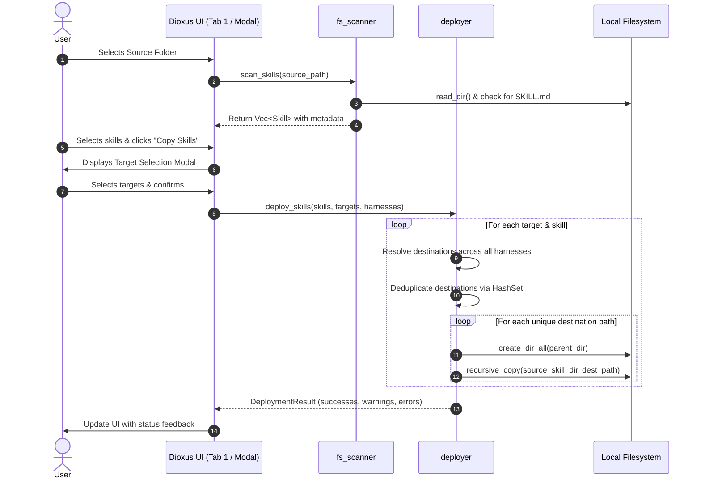

# Skill-Manager Design Document

* Author: Sven Kalbhenn
* Status: In Review
* Date: 2026-11-02

---

## Overview

Skill-Manager is a desktop application built in Rust using Dioxus 0.7 for managing and distributing LLM agent skills. Development workflows frequently rely on multiple AI coding assistants—such as Codex, Claude Code, Cursor, and Antigravity—each maintaining distinct configuration and skill directory conventions. Skill-Manager centralizes skill discovery from local source repositories and automates distribution across all target projects and global agent environments.

The application discovers skills identified by a `SKILL.md` marker file in immediate source subdirectories. When a user deploys skills to a project target or the Global target, Skill-Manager fans out full directory copies to all configured harnesses. Destination paths are deduplicated prior to execution so shared folders receive exactly one write. Application configuration is maintained in a single, atomically written configuration file (`~/.config/skill-manager/config.json`).

---

## Problem Statement

Developers using agentic AI tools face friction and fragmentation:

1. **Fragmented Directory Conventions**: Each AI harness uses different relative directories in project repositories (e.g., `.codex/skills`, `.claude/skills`, `.cursor/skills`, `.antigravity/skills`) and different global user paths (e.g., `~/.agents/skills`, `~/.claude/skills`).
2. **Manual and Error-Prone Replication**: Keeping custom skills updated across multiple projects and harnesses requires repetitive manual file copying or command-line scripting, resulting in outdated or partially copied skills.
3. **Overlapping Path Redundancy**: Multiple harnesses sometimes share identical folder paths (such as multiple tools standardizing on `.claude/skills` or shared global directories). Uncoordinated copy scripts perform redundant overwrites or encounter file lock conflicts.
4. **Lack of Centralized Visibility**: There is no straightforward way to view which skills are installed in a given project, which harnesses are currently configured with those skills, or to remove a skill across all harnesses in a single synchronized action.

Skill-Manager solves this by providing a responsive native desktop application to scan source directories, view discovered skills, fan out copies to project or global targets with automatic path deduplication, and inspect or delete installed skills consistently across all harnesses.

---

## Goals & Non-Goals

### Goals

* **Native Cross-Platform Desktop UI**: Deliver an intuitive, responsive cross-platform desktop interface using Rust and Dioxus 0.7 with native OS directory pickers via `rfd`.
* **Strict Skill Discovery**: Automatically detect valid agent skills within configured source folders by requiring an immediate child directory containing a `SKILL.md` marker file.
* **Multi-Harness Fan-Out**: Support selecting multiple skills and copying them simultaneously to selected target projects across all defined harnesses.
* **Destination Path Deduplication**: Resolve and deduplicate destination paths into canonical destinations before executing copy or deletion operations to avoid redundant I/O.
* **System-Wide Global Distribution**: Provide a built-in "Global" target that deploys skills across every harness's configured global folder path.
* **Missing Directory Initialization**: Automatically create required parent directory structures (`create_dir_all`) for each target harness path prior to file copying.
* **Synchronized Removal**: Enable removing an installed skill from a target project or global location, deleting it from all associated harness paths in a single action while leaving source directories untouched.
* **Resilient Error Handling**: Report errors encountered on specific harness paths without halting deployment to remaining valid harness targets.
* **Atomic Configuration Storage**: Maintain all sources, targets, and harness definitions in `~/.config/skill-manager/config.json` using atomic write operations (`tempfile` write followed by atomic replacement).
* **Non-Blocking Background I/O**: Offload all directory discovery, copying, and deletion tasks to asynchronous background workers (`dioxus::spawn` / `tokio::task::spawn_blocking`) to keep the desktop interface responsive.

### Non-Goals

* **Database Systems**: No inclusion of SQLite, embedded key-value engines, or multi-file configuration stores; configuration remains strictly within a single JSON file.
* **Symlinks and Directory Junctions**: Symlinking is excluded due to compatibility failures across various agent CLI harnesses; all deployments are direct full directory copies. Pre-existing symlinks in source directories are not followed during traversal.
* **In-App Skill Authoring**: No built-in Markdown editing, syntax linting, or skill authoring tools; authoring remains in user text editors and IDEs.
* **Remote Repositories & Registries**: No Git cloning, remote downloading, or public registry package management; operations are strictly local filesystem operations.
* **In-Place Target Updates Without Source**: No mechanism to edit or update installed skills directly inside target harness directories; source directories remain the single source of truth.
* **Two-Phase Transactional Rollback**: No staging directories or transactional rollback mechanisms across cross-filesystem mounts; copy operations overwrite target folders directly with per-harness error reporting.
* **Diffing and Conflict Merging**: No visual diffing or interactive merge resolution when overwriting existing target skill folders.

---

## Open Questions

None. (Resolved: Asynchronous background I/O tasks are used for all scanning, deployment, and removal operations to preserve UI responsiveness; skill discovery remains bounded to immediate child subdirectories `source_folder/<skill>/SKILL.md`.)

---

## Critical User Journeys (CUJs)

### CUJ 1: Discover and Deploy Skills to a Target Project

* **Given**: The user has added a source directory containing `git-helper` (with `git-helper/SKILL.md`) and a target project directory `~/projects/my-app`. Two harnesses are active: Codex (`.codex/skills`) and Claude Code (`.claude/skills`).
* **When**: The user opens Tab 1, selects `git-helper`, clicks "Copy Skills", checks `~/projects/my-app`, and confirms the dialog.
* **Then**: Skill-Manager resolves the two harness destination paths, creates parent directories if missing, recursively copies the skill directory into `~/projects/my-app/.codex/skills/git-helper` and `~/projects/my-app/.claude/skills/git-helper`, and displays `git-helper` under `my-app` in Tab 2 with both harness labels.

### CUJ 2: Deploy Skills Globally Across All Harnesses

* **Given**: Harnesses configured with global paths (e.g., Codex at `~/.agents/skills`, Claude Code at `~/.claude/skills`).
* **When**: The user selects `git-helper` in Tab 1, clicks "Copy Skills", and selects the pinned "Global" target.
* **Then**: The application deduplicates the destination paths, copies the full skill directory to each unique global directory, and reports a warning for any harness missing a configured global path while successfully completing the others.

### CUJ 3: Remove Installed Skill from Target Project

* **Given**: Target project `~/projects/my-app` contains `git-helper` deployed across multiple harness folders.
* **When**: The user navigates to Tab 2, locates `git-helper` under `my-app`, and clicks "Remove Skill".
* **Then**: The application resolves all harness subpaths for `git-helper` inside `my-app`, deletes each directory from disk, and removes the skill entry from the target's installed list in the UI without modifying the source folder.

---

## Proposed Architecture

### Architectural Overview

Skill-Manager follows a modular, layered architecture separating user interface presentation, application state, and filesystem engine operations:

```text
+-----------------------------------------------------------------------+
|                             Dioxus 0.7 GUI                            |
|  [Tab 1: Sources]       [Tab 2: Targets]       [Tab 3: Harnesses]     |
|   - Source List          - Target List          - Harness Matrix      |
|   - Skill Discovery      - Installed Skills     - Rel/Global Paths    |
|   - Copy Modal           - Removal Trigger      - Defaults Seed       |
+-----------------------------------------------------------------------+
                                   |
                                   v
+-----------------------------------------------------------------------+
|                       Application State & Signals                     |
|  - AppConfig (sources, targets, harnesses)                            |
|  - UI State (active_tab, selected_source, selected_target, selection) |
+-----------------------------------------------------------------------+
        |                                  |
        v                                  v
+-----------------------+        +--------------------------------------+
|  Storage Subsystem    |        |       Filesystem Engine Subsystems   |
|  (config_store.rs)    |        |                                      |
|  - Atomic Save        |        |  fs_scanner.rs:                      |
|  - Tilde Expansion    |        |   - Discover SKILL.md (case-insens.) |
|  - Default Seeding    |        |   - Name Sanitization & YAML Parse   |
|                       |        |                                      |
|                       |        |  deployer.rs (async background):     |
|                       |        |   - Resolve Harness Destinations     |
|                       |        |   - Lexical Path Dedup (HashSet)     |
|                       |        |   - Recursive Copy (no follow links) |
|                       |        |   - Boundary-Safe Multi-Path Delete  |
+-----------------------+        +--------------------------------------+
        |                                  |
        +------------------+---------------+
                           |
                           v
+-----------------------------------------------------------------------+
|                          Operating System                             |
|  - ~/.config/skill-manager/config.json                                |
|  - Native Folder Pickers (rfd)                                        |
|  - Target Project Repositories & Global Harness Directories           |
+-----------------------------------------------------------------------+
```

### Component Breakdown & Module Organization

The codebase is organized into three primary modules within `src/`:

```text
src/
├── main.rs                 # Application entry point, window init, root component
├── models/
│   ├── mod.rs              # Module exports
│   ├── config.rs           # AppConfig, SourceConfig, TargetConfig, HarnessConfig
│   └── skill.rs            # Skill, SkillFrontmatter, InstalledSkill
├── services/
│   ├── mod.rs              # Module exports
│   ├── config_store.rs     # Load/save config.json, tilde expansion, atomic writes
│   ├── fs_scanner.rs       # Scanning immediate folders, frontmatter parsing
│   └── deployer.rs         # Path deduplication, recursive copying, deletion
└── components/
    ├── mod.rs              # Module exports
    ├── layout.rs           # Root layout, navigation tabs, dark mode container
    ├── tab_sources.rs      # Tab 1: Sources list & discovered skills table
    ├── tab_targets.rs      # Tab 2: Targets list, installed skills, harness tags
    ├── tab_harnesses.rs    # Tab 3: Harness configuration & path inputs
    ├── copy_modal.rs       # Multi-target selection modal for skill copying
    └── common.rs           # Path picker buttons (rfd), status badges, buttons
```

### Data Models & Configuration Schema

All state is serialized to and from a single JSON file (`~/.config/skill-manager/config.json`).

```rust
// models/config.rs
use serde::{Deserialize, Serialize};
use std::path::PathBuf;

#[derive(Clone, Debug, Serialize, Deserialize, PartialEq)]
pub struct AppConfig {
    pub sources: Vec<SourceConfig>,
    pub targets: Vec<TargetConfig>,
    pub harnesses: Vec<HarnessConfig>,
}

#[derive(Clone, Debug, Serialize, Deserialize, PartialEq)]
pub struct SourceConfig {
    pub id: String,
    pub name: String,
    pub path: PathBuf,
}

#[derive(Clone, Debug, Serialize, Deserialize, PartialEq)]
pub struct TargetConfig {
    pub id: String,
    pub name: String,
    pub path: PathBuf,
    pub is_global: bool,
    pub is_pinned: bool,
}

#[derive(Clone, Debug, Serialize, Deserialize, PartialEq)]
pub struct HarnessConfig {
    pub id: String,
    pub name: String,
    pub relative_path: PathBuf,
    pub global_path: Option<PathBuf>,
    pub is_pinned: bool,
}

// models/skill.rs
#[derive(Clone, Debug, PartialEq)]
pub struct Skill {
    pub name: String,
    pub folder_path: PathBuf,
    pub title: Option<String>,
    pub description: Option<String>,
}

#[derive(Clone, Debug, PartialEq)]
pub struct InstalledSkill {
    pub name: String,
    pub harness_names: Vec<String>,
    pub installed_paths: Vec<PathBuf>,
}
```

### Pre-Seeded Default Harness Configuration

When `config.json` does not exist at startup, `config_store` initializes the configuration with standard AI coding harnesses:

| Harness Name | Relative Project Path | Global Path | Pinned |
|---|---|---|---|
| **Codex** | `.codex/skills` | `~/.agents/skills` | No |
| **Claude Code** | `.claude/skills` | `~/.claude/skills` | No |
| **Cursor** | `.cursor/skills` | `~/.cursor/skills` | No |
| **Antigravity** | `.antigravity/skills` | `~/.gemini/antigravity/skills` | No |

A default "Global" target is pre-seeded in `targets` (`id: "global"`, `name: "Global"`, `path: PathBuf::new()`, `is_global: true`, `is_pinned: true`). When deploying to the Global target, destination directories are resolved strictly from each harness's configured `global_path` rather than `target.path`. The UI disables the "Remove Target" button for any target where `is_pinned` is true.

### Execution Flows & Subsystems

#### 1. Configuration & Tilde Resolution (`config_store.rs`)
* **Path Resolution**: Standard Rust path handling cannot expand `~`. The helper function `expand_tilde(path: &Path) -> PathBuf` uses `dirs::home_dir()` to replace leading `~` or `~/` with the user's home directory across Linux, macOS, and Windows.
* **Atomic Persistence**:
  1. Determine config directory `dirs::config_dir().join("skill-manager")` (or `~/.config/skill-manager`).
  2. Create directory hierarchy with `std::fs::create_dir_all`.
  3. Write formatted JSON to a temporary file via `tempfile::NamedTempFile` created inside the target config folder.
  4. Perform atomic replacement (`persist` or platform-resilient rename), ensuring cross-platform safety on Windows without failing on existing destination files.

#### 2. Skill Discovery Subsystem (`fs_scanner.rs`)
* **Scanning Rule**: Given a configured `SourceConfig.path`:
  1. Expand tilde and verify folder existence (`path.exists()`). If nonexistent, mark the source as invalid/missing in the UI.
  2. Iterate through immediate entries in `std::fs::read_dir(path)`.
  3. For each sub-entry that is a directory, check for marker file `SKILL.md` (case-insensitively accepting `skill.md` or `Skill.md` across platforms).
  4. If the marker file exists, read its contents. If YAML frontmatter delimited by `---` exists at the start of the file, parse `name`, `title`, and `description`.
  5. Validate `skill.name` against regex `^[a-zA-Z0-9_-]+$`. If `name` contains path separators (`/`, `\`), traversal tokens (`..`), or is empty, or if YAML parsing fails, emit a warning and fall back to using the sanitized directory basename as the skill name with an empty description.
  6. Return `Vec<Skill>`.

#### 3. Fan-Out Deployment & Deduplication Engine (`deployer.rs`)
* **Asynchronous Execution**: Operations are spawned into background worker tasks (`dioxus::spawn` / `tokio::task::spawn_blocking`) to keep the Dioxus UI thread fully responsive during filesystem I/O.
* **Deployment Sequence**:
  1. Receive list of selected `Skill` objects and target IDs.
  2. For each target:
     * If `target.is_global`:
       * Collect `(harness.name, harness.global_path.as_ref())` for each harness where `global_path` is configured.
       * If any harness lacks a `global_path`, accumulate a warning message.
       * Validate `skill.name` against `^[a-zA-Z0-9_-]+$`.
       * Build destination path: `expand_tilde(global_path).join(&skill.name)`.
     * If project target:
       * Validate that `harness.relative_path` is strictly relative (`is_relative()`) and contains no parent components (`..`).
       * Build destination path: `target.path.join(&harness.relative_path).join(&skill.name)`.
     * **Path Deduplication**:
       * Apply lexical path normalization (collapsing redundant separators and relative segments without querying non-existent disk nodes).
       * Insert into `HashSet<PathBuf>` to eliminate duplicates caused by harnesses sharing identical subpaths or global paths.
       * Maintain mapping of `PathBuf -> Vec<HarnessName>` to report status and warnings accurately.
     * **Boundary Verification & Recursive Copy**:
       * For each unique `PathBuf`:
         * Verify that `dest_path` starts with the target base root (`dest_path.starts_with(&base_dir)`) to eliminate arbitrary traversal.
         * Ensure parent directory exists via `std::fs::create_dir_all(dest_path.parent())`.
         * Recursively copy files and directories from `skill.folder_path` to `dest_path` using `walkdir::WalkDir::new(...).follow_links(false)`. Directory symlinks are skipped, and file symlinks are not followed, preventing external data leaks and recursion loops.
         * Overwrite existing files directly without prompt or diffing.
  3. Aggregate any per-path I/O errors and return a `DeploymentResult` containing success counts, warnings, and detailed error messages.

#### 4. Synchronized Removal Flow
* **Deletion Sequence**:
  1. Executed asynchronously in a background worker task.
  2. Given a target and validated skill name (`^[a-zA-Z0-9_-]+$`), iterate over all configured harnesses.
  3. Resolve the skill's directory path for each harness (relative for project targets, global for Global target).
  4. Verify that each candidate path starts with the target project root or harness global root to enforce deletion boundary containment.
  5. Filter to paths that exist on disk, deduplicated via `HashSet<PathBuf>`.
  6. Call `std::fs::remove_dir_all(path)` for each unique validated path.
  7. The source directory in Tab 1 remains untouched.

#### 5. Data Flow Diagram



---

## Alternatives Considered

### Alternative 1: SQLite or Multi-File Storage vs. Consolidated JSON Configuration

* **Evaluated Options**:
  * *SQLite Database (`rusqlite`)*: Provides relational schemas and ACID transactions.
  * *YAML Configuration Files*: Common format for developer tool configurations.
  * *Separate JSON Files*: Storing `sources.json`, `targets.json`, and `harnesses.json` independently.
  * *Consolidated JSON File (`~/.config/skill-manager/config.json`)*: Single JSON file for all configuration state.
* **Pros of Consolidated JSON**: Single source of truth, human-readable and inspectable, zero external database driver dependencies, straightforward to back up or reset, and allows atomic writes via temporary file replacement.
* **Cons of Consolidated JSON**: Entire file is re-serialized on every save; no partial updates or fine-grained row-level locking.
* **Reason for Rejection of Alternatives**: SQLite introduces external binary dependencies, C compiler requirements for `rusqlite`, and non-inspectable storage with no functional benefit for configuration lists under a few dozen items. The Rust YAML ecosystem has deprecated key crates (`serde_yaml` is archived) and suffers from ambiguous type coercion. Separate JSON files create multi-file synchronization hazards where a crash mid-save could corrupt one entity while leaving others stale.

### Alternative 2: Symlinks vs. Direct Recursive File Copying

* **Evaluated Options**:
  * *Filesystem Symlinks / Directory Junctions*: Create symbolic links from target harness paths pointing back to the source skill directory.
  * *Direct Recursive Directory Copying*: Recursively duplicate all files and folders into each harness destination.
* **Pros of Recursive Copying**: Universal compatibility across all agent environments, platforms, and filesystem types. Isolated edits in a target do not corrupt the source.
* **Cons of Recursive Copying**: Consumes additional disk space (typically under 500 KB per skill) and requires explicit re-deployment when source skills change.
* **Reason for Rejection of Symlinks**: Multiple AI agent CLIs (e.g., Cursor background workers or sandboxed CLI harnesses) fail to resolve or follow symlinked directories properly, or reject them outright during security audits. Furthermore, NTFS directory junctions on Windows require elevated permissions or specific developer mode settings.

### Alternative 3: Direct Sequential Copying vs. Pre-Copy Destination Deduplication

* **Evaluated Options**:
  * *Direct Sequential Copying Without Deduplication*: Iterating over every configured harness sequentially and copying files directly to its designated path.
  * *Pre-Copy Path Deduplication via `HashSet<PathBuf>`*: Resolving all target destinations up front, converting to lexically normalized unique paths, and copying exactly once per path.
* **Pros of Deduplication**: Eliminates redundant disk I/O, prevents race conditions or file-lock conflicts when two harnesses point to the same directory (such as `.claude/skills`), and ensures clean status reporting.
* **Cons of Deduplication**: Requires two passes: an initial destination resolution step followed by deduplicated execution.
* **Reason for Rejection of Direct Copying**: Multiple harnesses frequently share directory conventions or global directories. Copying without deduplication overwrites the same destination folder multiple times in the same operation, creating redundant disk writes and confusing error traces if an operation fails.

### Alternative 4: Two-Phase Transactional Rollback vs. Direct Overwrite with Error Continuation

* **Evaluated Options**:
  * *Two-Phase Staged Atomic Copy*: Copy skills to temporary folders in the target and atomically swap them, rolling back the entire operation if any harness fails.
  * *Direct Overwrite with Resilient Error Continuation*: Copy directly into target paths, overwrite existing files, log errors per harness path, and allow remaining paths to succeed.
* **Pros of Error Continuation**: Simple, robust execution model; partial failures in one misconfigured harness path do not block deployment to other functional harnesses.
* **Cons of Error Continuation**: If an operation fails mid-folder on a specific harness, that specific harness folder may be left partially updated.
* **Reason for Rejection of Two-Phase Rollback**: Two-phase atomic swapping across diverse target directories (and potentially cross-filesystem mount boundaries) introduces extensive failure recovery complexity for a developer tool operating on small text directories already tracked in Git.

### Alternative 5: Dedicated Task Queue Engine vs. Direct Asynchronous Tasks via `dioxus::spawn`

* **Evaluated Options**:
  * *Dedicated Multi-Threaded Task Queue Manager*: Implement an elaborate background thread queue with channel routing, priority queues, and cancel tokens.
  * *Direct Asynchronous Tasks via `dioxus::spawn`*: Offload filesystem I/O (discovery scans, fan-out copying, and multi-path deletions) to background async tasks using `dioxus::spawn` / `tokio::task::spawn_blocking`.
  * *Synchronous I/O on UI Thread*: Execute filesystem operations directly within UI event callbacks.
* **Pros of `dioxus::spawn` Async Tasks**: Keeps the desktop event loop responsive (no UI freezing on network shares or large directories) while avoiding the architectural bloat of a custom queue manager.
* **Cons of `dioxus::spawn` Async Tasks**: Requires managing reactive status signals for UI loading indicators.
* **Reason for Rejection of UI Thread Synchronous I/O**: Performing blocking recursive directory I/O directly in UI event callbacks risks freezing the Dioxus/Tao window event loop (triggering macOS beachballs or OS application-hang dialogs) when operating on slow network drives (SMB/NFS) or cloud-synced folders (iCloud/OneDrive).

---

## Risks & Mitigations

### 1. Active File Lock Conflicts
* **Risk**: Running AI assistant processes (e.g. Cursor, Claude Code, or Codex CLI) or open editor instances may hold open file locks on skill files in target harness folders, causing copy or delete operations to fail with access denial errors.
* **Mitigation**: Deployments write files with per-file error capture; if an individual file within a destination is locked, the error is recorded in `DeploymentResult` without aborting writes to other files or targets. The UI surfaces an actionable notification identifying the locked path so the user can release the file.

### 2. Mid-Operation Partial Writes
* **Risk**: A sudden power failure, exhausted disk quota, or permission revocation during recursive copying could leave a destination directory partially written.
* **Mitigation**: The deployment engine performs pre-flight destination directory checks and per-target boundary validation before copying. Because source folders are never modified and deployments are idempotent full copies, users can simply re-trigger "Copy Skills" to overwrite and repair any incomplete target state.

### 3. Symlink Traversal & Host Leaks
* **Risk**: User-created skill repositories may contain circular symlinks or symlinks pointing outside the skill root (e.g. to `~/.ssh` or system directories), risking host data leaks into target projects or infinite recursion crashes during recursive copying.
* **Mitigation**: The directory scanner and recursive copy engine explicitly configure `walkdir::WalkDir::new(...).follow_links(false)`. Directory symlinks are skipped, and symlink references are not followed, preventing traversal escapes and recursion loops.

### 4. Filesystem Case Sensitivity & Path Discrepancies
* **Risk**: Linux filesystems are case-sensitive (`SKILL.md` vs `skill.md`), while macOS (APFS) and Windows (NTFS) default to case-insensitive. A skill authored on macOS with `skill.md` would fail discovery when shared to a Linux host.
* **Mitigation**: The discovery scanner uses case-insensitive matching for the marker filename across all operating systems. Path deduplication applies lexical path normalization, resolving separators and relative segments uniformly across platforms.

---

## Non-Functional Requirements

### Security & Privacy
* **Strictly Local Operations**: Skill-Manager executes entirely offline. No telemetry is collected, and no external API requests or network connections are made.
* **Path Traversal & Deletion Boundary Guard**: Skill names extracted from YAML frontmatter are strictly validated against regex `^[a-zA-Z0-9_-]+$`, rejecting path separators (`/`, `\`), parent traversal tokens (`..`), or empty strings. Harness relative paths are verified to be strictly relative. Every destination path is checked to ensure it starts with the target project root or harness global directory (`dest.starts_with(&base_dir)`) before copying or calling `std::fs::remove_dir_all`.
* **Tilde Path Sanitization**: Tilde expansion is executed strictly through `dirs::home_dir()` to prevent arbitrary home path escapes.

### Performance & Latency
* **Non-Blocking Background I/O**: Filesystem scans, directory copying, and deletion flows run in background asynchronous tasks (`dioxus::spawn`), preserving 60 FPS UI rendering and immediate user input handling.
* **Discovery Speed**: Immediate-folder scanning ensures scanning a source folder containing dozens of skills completes in under 10 ms.
* **Copy Throughput**: Pre-copy destination path deduplication eliminates redundant I/O operations, ensuring sub-50 ms deployment times for multi-skill selections.
* **Application Startup**: Cold start time from executable launch to rendered Dioxus UI remains under 200 ms.

### Rollout & Rollback
* **Configuration Resilience**: Atomic writes to `config.json` via `tempfile::NamedTempFile` and atomic persistence prevent partial writes or corruption on abrupt termination across Windows, macOS, and Linux. If `config.json` is missing or corrupted, the application regenerates a clean default configuration on startup.

---

## Detailed Implementation Plan

The implementation is partitioned into five incremental, testable phases. Each phase leaves the codebase in a stable, buildable, and testable state with an explicit verification checkpoint before proceeding.

### Phase 1: Project Setup, Build Manifests & Domain Models

* **Goal**: Establish the Cargo package configuration, dependencies, error handling structures, domain data models, and centralized reactive state containers.
* **Checkpoint**: `cargo check`

#### Tasks & Target Files

* **File**: `Cargo.toml` (Create)
  * **Scope**: Cargo package manifest and dependencies.
  * **Specification**: Configures package name `skill-manager`, version `0.1.0`, edition `2021`, and defines dependencies:
    ```toml
    [dependencies]
    dioxus = { version = "0.7", features = ["desktop"] }
    serde = { version = "1.0", features = ["derive"] }
    serde_json = "1.0"
    yaml-rust2 = "0.8"
    rfd = "0.15"
    dirs = "5.0"
    walkdir = "2.5"
    regex = "1.10"
    tempfile = "3.10"
    thiserror = "1.0"
    tokio = { version = "1.38", features = ["rt", "rt-multi-thread"] }
    ```
* **File**: `Dioxus.toml` (Create)
  * **Scope**: Dioxus CLI packaging configuration.
  * **Specification**: Defines desktop application metadata (name: "Skill-Manager", executable: "skill-manager", bundle identifier: "com.skillmanager.desktop").
* **File**: `src/error.rs` (Create)
  * **Scope**: Centralized application error handling.
  * **Specification**: Implements `AppError` using `thiserror::Error`:
    ```rust
    #[derive(Debug, thiserror::Error)]
    pub enum AppError {
        #[error("I/O error: {0}")]
        Io(#[from] std::io::Error),
        #[error("JSON serialization error: {0}")]
        Json(#[from] serde_json::Error),
        #[error("Invalid path: {0}")]
        InvalidPath(std::path::PathBuf),
        #[error("Path traversal security violation: {0}")]
        TraversalAttempt(String),
        #[error("Frontmatter parsing error: {0}")]
        Frontmatter(String),
        #[error("Configuration error: {0}")]
        Config(String),
    }
    ```
* **File**: `src/models/mod.rs` (Create)
  * **Scope**: Module declarations.
  * **Specification**: Re-exports `config`, `skill`, and `state` submodules.
* **File**: `src/models/config.rs` (Create)
  * **Scope**: Configuration domain models.
  * **Specification**: Implements `AppConfig`, `SourceConfig`, `TargetConfig` (with `pub is_pinned: bool`), and `HarnessConfig` structs with `Serialize`, `Deserialize`, `Clone`, `Debug`, and `PartialEq` derives. Includes helper method `AppConfig::default_seeded()` initializing Codex, Claude Code, Cursor, Antigravity, and the pinned Global target.
* **File**: `src/models/skill.rs` (Create)
  * **Scope**: Skill domain representations and frontmatter definitions.
  * **Specification**: Implements `Skill`, `SkillFrontmatter`, `InstalledSkill`, and `DeploymentResult`:
    ```rust
    #[derive(Clone, Debug, PartialEq)]
    pub struct Skill {
        pub name: String,
        pub folder_path: std::path::PathBuf,
        pub title: Option<String>,
        pub description: Option<String>,
    }

    #[derive(Clone, Debug, serde::Deserialize, serde::Serialize, PartialEq, Default)]
    pub struct SkillFrontmatter {
        pub name: Option<String>,
        pub title: Option<String>,
        pub description: Option<String>,
    }

    #[derive(Clone, Debug, PartialEq)]
    pub struct InstalledSkill {
        pub name: String,
        pub harness_names: Vec<String>,
        pub installed_paths: Vec<std::path::PathBuf>,
    }

    #[derive(Clone, Debug, Default, PartialEq)]
    pub struct DeploymentResult {
        pub copied_paths: Vec<std::path::PathBuf>,
        pub warnings: Vec<String>,
        pub errors: Vec<(std::path::PathBuf, String)>,
    }
    ```
* **File**: `src/models/state.rs` (Create)
  * **Scope**: Centralized reactive UI state.
  * **Specification**: Defines navigation enum and `AppState`:
    ```rust
    #[derive(Clone, Copy, PartialEq, Debug, Default)]
    pub enum ActiveTab {
        #[default]
        Sources,
        Targets,
        Harnesses,
    }

    #[derive(Clone, Copy)]
    pub struct AppState {
        pub config: dioxus::prelude::Signal<crate::models::config::AppConfig>,
        pub active_tab: dioxus::prelude::Signal<ActiveTab>,
        pub selected_source_id: dioxus::prelude::Signal<Option<String>>,
        pub selected_target_id: dioxus::prelude::Signal<Option<String>>,
        pub selected_skill_names: dioxus::prelude::Signal<std::collections::HashSet<String>>,
        pub is_copy_modal_open: dioxus::prelude::Signal<bool>,
        pub status_message: dioxus::prelude::Signal<Option<String>>,
    }
    ```

---

### Phase 2: Configuration & Persistence Engine

* **Goal**: Build and test the atomic JSON storage engine and tilde expansion helpers.
* **Checkpoint**: `cargo test --test config_store_tests`

#### Tasks & Target Files

* **File**: `src/services/mod.rs` (Create)
  * **Scope**: Service module exports.
  * **Specification**: Re-exports `config_store`, `fs_scanner`, and `deployer` modules.
* **File**: `src/services/config_store.rs` (Create)
  * **Scope**: Configuration persistence and path normalization.
  * **Specification**:
    * Implements `expand_tilde(path: &std::path::Path) -> std::path::PathBuf` using `dirs::home_dir()`.
    * Implements `load_config() -> Result<AppConfig, AppError>`: reads `~/.config/skill-manager/config.json`, returning default seeded config if file does not exist.
    * Implements `save_config(config: &AppConfig) -> Result<(), AppError>`: writes formatted JSON to a `tempfile::NamedTempFile` created in the config directory, calling `persist` for cross-platform atomic replacement.
* **File**: `tests/common/mod.rs` (Create)
  * **Scope**: Shared test fixtures.
  * **Specification**: Provides helper functions `create_mock_config_dir()`, `create_mock_source_with_skills()`, and `create_mock_project_target()` using `tempfile::tempdir()`.
* **File**: `tests/config_store_tests.rs` (Create)
  * **Scope**: Configuration store test suite.
  * **Specification**: Tests `test_tilde_expansion_resolves_home_dir`, `test_default_config_seeding_when_file_missing`, `test_atomic_config_save_replaces_cleanly`, and `test_corrupt_config_recovers_to_default`.

---

### Phase 3: Filesystem Discovery & Deployment Services

* **Goal**: Implement immediate-child skill scanning, frontmatter parsing, lexical path deduplication, boundary-safe fan-out copying, and batch directory deletion.
* **Checkpoint**: `cargo test --test fs_scanner_tests --test deployer_tests`

#### Tasks & Target Files

* **File**: `src/services/fs_scanner.rs` (Create)
  * **Scope**: Source folder discovery and installed skills aggregation.
  * **Specification**:
    * Implements `scan_skills(source_path: &std::path::Path) -> Result<Vec<Skill>, AppError>`: iterates immediate entries in `std::fs::read_dir`, checks case-insensitively for `SKILL.md` (or `skill.md`), extracts frontmatter between opening and closing `---` delimiters using `yaml-rust2`, validates `skill.name` with regex `^[a-zA-Z0-9_-]+$`, and falls back to sanitized folder basename if frontmatter is invalid or missing.
    * Implements `scan_installed_skills(target: &TargetConfig, harnesses: &[HarnessConfig]) -> Vec<InstalledSkill>`: iterates configured harnesses, resolves target subpaths, checks for child folders containing `SKILL.md`, groups matching folder basenames into `InstalledSkill`, and populates `harness_names` and `installed_paths`.
* **File**: `src/services/deployer.rs` (Create)
  * **Scope**: Fan-out deployment, deduplication, and removal engine.
  * **Specification**:
    * Implements `deploy_skills(skills: &[Skill], targets: &[TargetConfig], harnesses: &[HarnessConfig]) -> DeploymentResult`: resolves destinations across harnesses (relative for project targets, global for Global target), validates that `harness.relative_path` is strictly relative, applies lexical path normalization, deduplicates destinations via `HashSet<PathBuf>`, verifies boundary containment (`dest_path.starts_with(&base_dir)`), creates parent directories, copies files recursively using `walkdir::WalkDir::new(...).follow_links(false)` to skip directory symlinks, and returns structured `DeploymentResult`.
    * Implements `remove_skill_from_target(skill_name: &str, target: &TargetConfig, harnesses: &[HarnessConfig]) -> Result<(), AppError>`: validates `skill_name` against `^[a-zA-Z0-9_-]+$`, resolves harness paths, verifies boundary containment, and performs batch deletion across all configured harness directories via `std::fs::remove_dir_all`.
* **File**: `tests/fs_scanner_tests.rs` (Create)
  * **Scope**: Discovery scanner test suite.
  * **Specification**: Tests `test_scan_skills_discovers_valid_skill_marker`, `test_scan_skills_case_insensitive_marker`, `test_scan_skills_parses_yaml_frontmatter`, `test_scan_skills_ignores_directory_symlinks`, `test_scan_skills_malformed_frontmatter_fallback`, and `test_scan_installed_skills_aggregates_across_harnesses`.
* **File**: `tests/deployer_tests.rs` (Create)
  * **Scope**: Deployment and deletion test suite.
  * **Specification**: Tests `test_deploy_creates_parent_directories`, `test_deploy_deduplicates_overlapping_destinations`, `test_deploy_enforces_destination_containment`, `test_deploy_skips_internal_directory_symlinks`, `test_deploy_reports_error_on_locked_destination`, and `test_remove_skill_deletes_across_all_harness_paths`.

---

### Phase 4: UI Shell, Layout & Feature Tabs

* **Goal**: Build the Dioxus 0.7 desktop user interface, navigation tabs, modal dialogs, and dark mode stylesheet.
* **Checkpoint**: `cargo check`

#### Tasks & Target Files

* **File**: `assets/style.css` (Create)
  * **Scope**: Desktop UI dark mode stylesheet.
  * **Specification**: Defines dark theme CSS variables (background `#18181b`, surface `#27272a`, text `#f4f4f5`, border `#3f3f46`, accent `#6366f1`), flex/grid two-pane layouts, badge classes, and modal backdrop styling.
* **File**: `src/components/mod.rs` (Create)
  * **Scope**: UI components module exports.
  * **Specification**: Re-exports `layout`, `tab_sources`, `tab_targets`, `tab_harnesses`, `copy_modal`, and `common`.
* **File**: `src/components/common.rs` (Create)
  * **Scope**: Shared UI primitives.
  * **Specification**: Implements buttons, status pills (e.g., "Active", "Missing"), directory picker triggers via `rfd::FileDialog`, and feedback banners for warnings and errors.
* **File**: `src/components/copy_modal.rs` (Create)
  * **Scope**: Target selection modal dialog.
  * **Specification**: Modal dialog triggered when "Copy Skills" is clicked. Clones selected skills and targets into owned `Vec`s before spawning deployment into background worker tasks (`dioxus::spawn` / `tokio::task::spawn_blocking`), updating `AppState.status_message` upon completion.
* **File**: `src/components/tab_sources.rs` (Create)
  * **Scope**: Tab 1 (Source Folders & Discovered Skills).
  * **Specification**: Two-pane view. Left pane: list of source folders with existence pills, "Add Source" button invoking `rfd`, and "Remove Source" button. Right pane: discovered skills table for the selected source, checkbox selectors, select-all toggle, description preview, and "Copy Skills" trigger button.
* **File**: `src/components/tab_targets.rs` (Create)
  * **Scope**: Tab 2 (Targets & Installed Skills).
  * **Specification**: Two-pane view. Left pane: list of targets with pinned "Global" target at the top (disabling "Remove Target" for pinned items), "Add Target" button invoking `rfd`, and "Remove Target" button. Right pane: table of installed skills found in the selected target, badges for each harness mapping to that skill, and "Remove Skill" button triggering batch deletion across all configured harness directories via a background task.
* **File**: `src/components/tab_harnesses.rs` (Create)
  * **Scope**: Tab 3 (Harness / IDE Configuration).
  * **Specification**: Left pane: list of configured harnesses (Codex, Claude Code, Cursor, Antigravity, custom) with "Add Harness" and "Remove Harness" buttons. Right pane: editable form fields for harness display name, relative project subfolder path, and global folder path with `rfd` picker button.
* **File**: `src/components/layout.rs` (Create)
  * **Scope**: Application shell layout.
  * **Specification**: Implements header with tab navigation (Sources, Targets, Harnesses), injects `assets/style.css`, renders the active tab component according to `AppState.active_tab`, and mounts the copy modal dialog overlay.
* **File**: `src/main.rs` (Create)
  * **Scope**: Desktop application entry point.
  * **Specification**: Programmatically configures Dioxus Desktop window (title: "Skill-Manager", size: 1100x750, min size: 900x600) via `dioxus::desktop::Config::default().with_window(...)`. Initializes `AppState`, provides context via `use_context_provider`, and mounts the root layout component.

---

### Phase 5: End-to-End Integration & Verification

* **Goal**: Execute the complete automated verification test suite, run static analysis and linting, and validate critical user journeys.
* **Checkpoint**: `cargo test && cargo clippy --all-targets -- -D warnings && cargo fmt --check`

---

## Verification Plan

### Automated Test Suite

* **Unit & Integration Tests**:
  ```bash
  cargo test
  ```
  Validates configuration persistence (`config_store_tests.rs`), immediate-child scanner behavior (`fs_scanner_tests.rs`), and fan-out path deduplication and batch deletion (`deployer_tests.rs`).
* **Static Analysis & Formatting**:
  ```bash
  cargo clippy --all-targets -- -D warnings
  cargo fmt --check
  ```
  Verifies formatting via `cargo fmt` and enforces zero compiler or Clippy warnings via `cargo clippy -- -D warnings`.

### Manual Verification Matrix

1. **Initial Boot & Pre-Seeding**:
   * Launch application with no existing `~/.config/skill-manager/config.json`.
   * Verify that Codex, Claude Code, Cursor, and Antigravity appear pre-seeded in Tab 3 and Global is present in Tab 2.
2. **Source Folder Addition & Scanning**:
   * Click "Add Source" in Tab 1, pick a folder containing skills with `SKILL.md`.
   * Verify discovered skills appear in the list with names, titles, and descriptions.
3. **Multi-Target Fan-Out Deployment**:
   * Select 2 skills in Tab 1, click "Copy Skills".
   * Select both a project target and the Global target.
   * Confirm that files are copied to all configured harness subpaths (`.codex/skills`, `.claude/skills`, etc.) and global directories.
   * Verify that overlapping paths are written exactly once without errors.
4. **Target Inspection & Removal**:
   * Open Tab 2, select the project target.
   * Verify deployed skills show tags for active harnesses.
   * Click "Remove Skill"; verify the folder is deleted from all harness subdirectories while remaining in the Tab 1 source folder.

